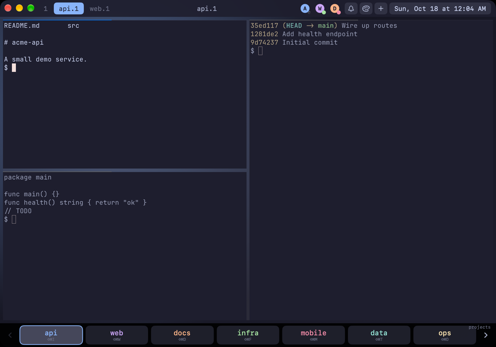
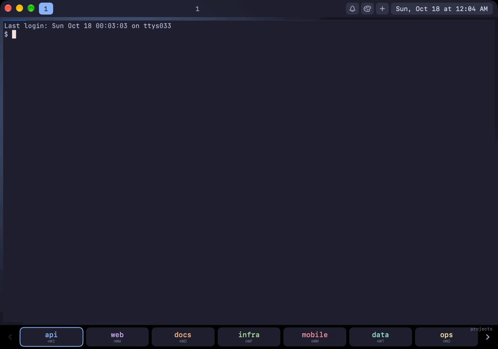

<h1 align="center">HyprMux</h1>
<p align="center"><b>Hyprland on macOS.</b> A terminal with a waybar-style top bar, a project dock,<br/>
dwindle tiling, workspaces, ssh + tmux terminals and live status for your AI coding agents.</p>

<p align="center">
  <a href="https://github.com/openloopagentics/hyprmux/releases/latest">Download</a> ·
  <a href="#configuration-at-a-glance">Configure</a> ·
  <a href="#for-ai-agents-customizing-a-users-bars">Let your agent set it up</a> ·
  <a href="#how-hyprmux-relates-to-cmux">About cmux</a>
</p>

<p align="center">
  
</p>

<p align="center">
  
</p>

<p align="center"><sub>Demo content only: a throwaway profile and a sample repo, captured from an isolated instance (see <code>HYPRMUX_HOME</code> below).</sub></p>

## What it is

If you live in a tiling Linux desktop, HyprMux gives you that muscle memory on a Mac:
maximize the window and it behaves like a [Hyprland](https://hypr.land) session, with
**Super = Cmd**. There is no sidebar and there are no per-pane tabs.

- **Top bar** (waybar-style): workspace pills, the current title, notifications, a theme picker, the clock, and one status icon per running coding agent.
- **Project dock** (Touch-Bar-style): a row of project buttons along the bottom, in layers (projects, customers, machines). Press `Cmd+Shift+<letter>` or click.
- **Dwindle tiling**: each new terminal splits the focused one along its longer side, like Hyprland, with gaps and keyboard resizing.
- **Workspaces**: numbered (`Cmd+1…9`), named (`api.1`), and sub-workspaces (`Cmd+]` makes `api.2`). A workspace you leave empty closes itself.
- **Remote terminals**: a project opens three terminals attached to tmux sessions on your own machines over ssh, and they reattach when you relaunch.
- **Agent status**: Any coding agent whose hooks append to a log file shows up as a spinner, a green dot (done) or a pink dot (needs you).
- **Browser pane**: `Cmd+Shift+B` and friends open a web page as a pane.
- **Wallpapers and themes**: a wallpaper under the tiles, six fixed terminal themes that never follow light/dark mode.
- **Plain-file config, written for agents**: two small text files describe the bars, and this README tells your AI agent how to edit them.

## Install

1. Download `HyprMux-<version>.dmg` from the [latest release](https://github.com/openloopagentics/hyprmux/releases/latest).
2. Open it and drag **HyprMux** to **Applications**.

macOS 14 or later, Apple silicon or Intel. The app is signed with a Developer ID and
notarized by Apple. It has no update checker (download new releases yourself) and sends
no telemetry. Browser passkeys and the shared keychain group are not available in this build.

## Quick start

1. Launch it. With no configuration you get placeholder projects (`alpha` … `lambda`) and local shells. Try `Cmd+Shift+O` to open a project, then `Cmd+Return` for another terminal and `Cmd+1…9` for numbered workspaces.
2. Make it yours: write `~/.config/agentic-laptop/bar.toml` ([format](#bartoml-reference)) and, for remote terminals and agent status, `~/.config/claude-badged/fleet` ([format](#fleet-reference)). Restart HyprMux.
3. Or skip the typing: tell your coding agent *"read the HyprMux README and set up my bars"*. See [For AI agents](#for-ai-agents-customizing-a-users-bars).

## How HyprMux relates to cmux

HyprMux is a fork of [**cmux**](https://github.com/manaflow-ai/cmux), the Ghostty-based macOS
terminal by Manaflow. cmux provides the engine this is built on: Ghostty terminal rendering,
the pane layout library, the browser panel and the notification plumbing. HyprMux replaces
cmux's sidebar-and-tabs interface with the Hyprland-style shell above (almost all of it in
[`Sources/AgenticShell.swift`](Sources/AgenticShell.swift)), and differs in a few practical ways:

- its own app name, icon and bundle identifier (`com.openloopagentics.hyprmux`), so it can sit next to cmux;
- no update feed and no telemetry;
- the cmux server directories under the Business Source License were removed.

It is an independent project and not affiliated with Manaflow. Thanks to the cmux and
Ghostty authors. The upstream README is kept as [`README.cmux.md`](README.cmux.md), and
[License and attribution](#license-and-attribution) has the details. HyprMux is
GPL-3.0-or-later, like cmux.

## Contents

- [What it is](#what-it-is) · [Install](#install) · [Quick start](#quick-start)
- [Build from source](#build-and-run)
- [Configuration at a glance](#configuration-at-a-glance)
- [`bar.toml` reference](#bartoml-reference)
- [`fleet` reference](#fleet-reference)
- [Agent status icons](#agent-status-icons)
- [Themes, wallpapers, icons](#themes-wallpapers-icons)
- [Keybindings](#keybindings)
- [For AI agents: customizing a user's bars](#for-ai-agents-customizing-a-users-bars)
- [License and attribution](#license-and-attribution)

## Build and run

Requirements: macOS, Xcode, `zig` 0.16 (`brew install zig@0.16`, then put
`/opt/homebrew/opt/zig@0.16/bin` on `PATH`).

```bash
./scripts/setup.sh        # one time: submodules, GhosttyKit
xcodebuild -project cmux.xcodeproj -scheme cmux -configuration Debug \
  -derivedDataPath build/dd build
open "build/dd/Build/Products/Debug/cmux DEV.app"
```

This builds the development app, `cmux DEV.app` (the Debug configuration keeps cmux's
dev names; the release build is called HyprMux). Rebuild after changing anything in
`Sources/`. The shell lives in `Sources/AgenticShell.swift`.

To run with a throwaway profile instead of yours, launch the binary with
`HYPRMUX_HOME=/some/folder "build/dd/Build/Products/Debug/cmux DEV.app/Contents/MacOS/cmux DEV"`
(see [Configuration](#configuration-at-a-glance)).

## Configuration at a glance

HyprMux reads plain files in your home directory. Nothing is required: with no
files it shows placeholder projects (`alpha` … `lambda`) and runs local shells.

| File | Purpose | Read |
|---|---|---|
| `~/.config/agentic-laptop/bar.toml` | Dock buttons: projects, customers, tool buttons, machines | at launch (restart to apply) |
| `~/.config/agentic-laptop/icons/<name>.svg\|png` | Button / agent icons | at launch |
| `~/.config/claude-badged/fleet` | Hosts: where terminals attach, which hosts report agent status | at launch |
| `~/.claude-badges.log` (on each machine) | Agent events: `<session> busy\|ask\|done` | live |
| `~/.config/ghostty/config` | Terminal theme (written by the theme picker) | live |
| `~/Pictures/wallpapers/*.{png,jpg,jpeg,webp,heic}` | Wallpaper library | on cycle |

Set `HYPRMUX_HOME=/some/folder` to make HyprMux read all of the above from that folder
instead of your home folder (a throwaway profile for demos or screenshots, for example).

The directory name `agentic-laptop` is historical: HyprMux uses the same
profile as the Linux (Hyprland + waybar + Touch Bar) setup, so one profile
drives both.

## `bar.toml` reference

HyprMux does **not** use a full TOML parser. It reads the file **line by line**,
so follow these rules exactly:

1. A list starts on its own line as `Name = [` and ends with a line that begins with `]`.
2. **One button per line**, written as an inline table that starts with `{`:
   `{ Text = "alpha", Action = [ "LeftMeta", "LeftShift", "O" ], Color = "blue", Badge = "alpha", Icon = "alpha" },`
3. Values are **double-quoted** strings. Single quotes and multi-line values are not read.
4. Lines starting with `#` and blank lines are ignored. Keys it does not know are ignored.
5. Only these lists are read; everything else in the file (Linux Touch Bar settings,
   `[Palette]`, `[ExtraLayers]` headers, …) is skipped, so a profile shared with
   Linux works unchanged.

### Lists

| List | Becomes | Chord |
|---|---|---|
| `PrimaryLayerKeys` | First dock layer: **projects** (buttons with `Badge`) and **tool buttons** (buttons with `Exec`) | `Cmd+Shift+<key>` |
| `MediaLayerKeys` | Second dock layer: **customers** (buttons with `Badge`). Same shape as projects | `Cmd+Shift+<key>` |
| `machines` | Third dock layer: ssh machines | `Cmd+Option+1…9`, in file order |

### Button keys

| Key | Used by | Meaning |
|---|---|---|
| `Text` | all (**required**: lines without it are skipped) | Label on the button |
| `Action` | projects, customers, tools | A list of quoted strings; **only the last one is used**, as the chord letter. `[ "LeftMeta", "LeftShift", "O" ]` means `Cmd+Shift+O` on macOS. The modifiers in the list are ignored here (they matter on Linux) |
| `Badge` | projects, customers | The workspace name this button opens (`Badge = "alpha"` opens workspace `alpha.1`). Also the name agent status icons match |
| `Color` | all | `blue` `mauve` `peach` `green` `red` `teal` `yellow`; anything else (e.g. `surface`) is neutral |
| `Icon` | all | File stem in `icons/` (`icons/alpha.svg` or `.png`). Without it the `Text` label is shown |
| `Exec` | tool buttons | Shell command to run; `$HOME` is expanded. A button with `Exec` and no `Badge` is a tool button |
| `Workspace` | machines | Workspace name (default: `Text`) |
| `Host` | machines | ssh target, `user@host` or an alias from `~/.ssh/config` |

A **project** = a button with `Badge` and an `Action`. Opening it creates workspace
`<Badge>.1` containing three terminals tiled Hyprland-style, attached to tmux
sessions `<Badge>`, `<Badge>1` and `<Badge>2` (on the first host of the `fleet`
file, or locally if none). Opening it again just focuses it.

### Minimal example

```toml
PrimaryLayerKeys = [
    { Text = "api",    Action = [ "LeftMeta", "LeftShift", "A" ], Color = "blue",  Badge = "api",    Icon = "api" },
    { Text = "web",    Action = [ "LeftMeta", "LeftShift", "W" ], Color = "mauve", Badge = "web" },
    { Text = "notes",  Exec = "$HOME/.local/bin/open-notes",      Action = [ "LeftMeta", "LeftShift", "N" ] },
]

MediaLayerKeys = [
    { Text = "acme",   Action = [ "LeftMeta", "LeftShift", "C" ], Color = "yellow", Badge = "acme" },
]

machines = [
    { Text = "server1", Workspace = "server1", Host = "me@server1", Color = "blue" },
    { Text = "server2", Workspace = "server2", Host = "server2",    Color = "green" },
]
```

### Chords that are already taken

`Cmd+Shift+` with `B A Y X P` (browser apps), `-`, `=`, `Return`, `Space` are built in
(see [Keybindings](#keybindings)). Do not assign those letters to projects, and keep
each letter unique across `PrimaryLayerKeys` and `MediaLayerKeys`: with duplicates the
first match wins.

## `fleet` reference

`~/.config/claude-badged/fleet`: one ssh target per line.

```
me@server1
me@server2
```

- The **first line** is where project terminals attach: `ssh -t <host> "tmux new -A -s '<session>' \; set -s escape-time 0"`.
  The `AGENTIC_REMOTE` environment variable overrides it. With no file, terminals run local tmux.
- **Every host** is followed for [agent status](#agent-status-icons).
- ssh must work non-interactively (`ssh -o BatchMode=yes <host> true` must succeed): use keys.

## Agent status icons

The top bar shows one icon per coding agent (up to 8), left of the bell:

| Look | Meaning |
|---|---|
| spinner on the icon | the agent is working |
| green dot | it finished |
| pink dot | it is asking you something |

Clicking an icon jumps to that agent's workspace; a finished agent then leaves the
bar (a working one stays). A `busy` older than 30 minutes is dropped.

**The contract**: each machine where agents run appends one line per event to
`~/.claude-badges.log`:

```
<tmux-session> busy
<tmux-session> ask
<tmux-session> done
```

HyprMux runs `tail -F` on the local log and, over ssh, on each `fleet` host. Only
events that arrive after launch are shown. The session name maps to a project by
stripping everything after a `.` and trailing digits: `api`, `api1`, `api2` and
`api.1` all belong to `Badge = "api"`, and the icon is that project's `Icon` (or its
first letter on its `Color`).

Wire the log to your agent's hooks. For example, for an agent running inside tmux
(adapt to your tool's hook mechanism):

```bash
# on "agent started working" / "tool used":
echo "$(tmux display-message -p '#S') busy" >> ~/.claude-badges.log
# on "needs input / permission":
echo "$(tmux display-message -p '#S') ask"  >> ~/.claude-badges.log
# on "finished":
echo "$(tmux display-message -p '#S') done" >> ~/.claude-badges.log
```

## Themes, wallpapers, icons

- **Terminal theme**: the palette button in the top bar offers Catppuccin Mocha, Tokyo
  Night, Gruvbox Dark, Dracula, Nord and Rose Pine. The choice is written to
  `~/.config/ghostty/config` as one `theme = …` line. Terminal colors never follow the
  OS light/dark setting. To use another [Ghostty theme](https://ghostty.org/docs/features/theme)
  or any other Ghostty option, edit that file (reload with the app menu's *Reload
  Configuration*); the picker only rewrites it when you pick from the menu.
- **Wallpapers**: drop images in `~/Pictures/wallpapers`. `Cmd+Ctrl+Space` cycles
  forward, `+Option` backward, `+Shift` random. Without images a gradient is used.
- **Icons**: `~/.config/agentic-laptop/icons/<name>.svg` or `.png`, referenced from
  `bar.toml` by stem (`Icon = "name"`). Square, transparent background, ~64px or SVG.

## Keybindings

Super = Cmd. Workspaces are numbered (`1`…`9`, created on demand), named
(`project.1`) or sub-workspaces (`project.2`, …). An empty workspace closes when you leave it.

| Keys | Action |
|---|---|
| `Cmd+1…9` | Go to / create numbered workspace |
| `Cmd+Shift+<letter>` | Open project or customer (from `bar.toml`) |
| `Cmd+[` / `Cmd+]` | Previous / next sub-workspace (`]` creates a new one) |
| `Ctrl+Tab` / `Ctrl+Shift+Tab` | Next / previous workspace |
| `Cmd+Ctrl+Tab`, `Cmd+Option+←/→` | Previously visited workspace, history back / forward |
| `Cmd+Return` | New terminal, split Hyprland-dwindle style |
| `Cmd+←↑↓→` | Focus pane |
| `Cmd+-` / `Cmd+=` | Resize left / right |
| `Cmd+Shift+-` / `Cmd+Shift+=` | Resize up / down |
| `Cmd+W` | Close focused pane |
| `Cmd+F` | Zoom focused pane |
| `Cmd+N` | Jump to the workspace needing attention |
| `Cmd+Option+1…9` | Open machine from `machines` |
| `Cmd+Ctrl+↑↓←→`, `Cmd+Ctrl+Return` | Dock: change layer, move selection, activate |
| `Cmd+Ctrl+Space` (+`Option` / +`Shift`) | Next / previous / random wallpaper |
| `Cmd+Shift+Space` | Toggle the top bar |
| `Cmd+Shift+B / A / Y / X / P` | Browser pane: web / ChatGPT / YouTube / X / Photos |
| `Cmd+Shift+Return` | Browser pane on a search page |

## For AI agents: customizing a user's bars

**Users: point your coding agent at this README** (for example: *"Read the README of
HyprMux and customize my bars: add a project for each repo in ~/code, …"*).

Everything customizable is a text file under your home directory; you never need to
edit or rebuild the app. Follow this procedure:

1. **Inspect the current state** before changing anything:
   `cat ~/.config/agentic-laptop/bar.toml ~/.config/claude-badged/fleet`,
   `ls ~/.config/agentic-laptop/icons ~/Pictures/wallpapers`. If a file is a symlink
   (a shared profile repo), edit the link target and tell the user.
2. **Back up** `bar.toml` (`cp bar.toml bar.toml.bak`) so the change can be reverted.
3. **Edit using the exact line format** in [`bar.toml` reference](#bartoml-reference):
   one `{ … }` button per line, double-quoted values, a unique `Cmd+Shift` letter per
   project. Prefer appending one line per new project or machine and keeping the
   existing ones.
4. **Check the invariants** after editing: every list still opens with `Name = [` and
   closes with a line starting `]`; every button line has `Text`; each project line
   has both `Badge` and `Action`; no chord letter is duplicated or one of
   `B A Y X P`; every `Icon = "x"` has an `icons/x.svg` or `icons/x.png`; every
   `Color` is one of the seven names.
5. **Tell the user to restart HyprMux** (`bar.toml`, icons and `fleet` are read at
   launch). Theme and wallpaper changes apply live.
6. **Do not** put secrets in these files, and do not change a host in `fleet` or
   `machines` without being told the exact `user@host`: the first `fleet` line is
   where every new terminal will ssh.

Common tasks:

| The user asks for | Do |
|---|---|
| "A project/button for repo X" | Append a `PrimaryLayerKeys` line with `Badge = "X"` and a free letter |
| "A customer / second row" | Same, in `MediaLayerKeys` |
| "Add a machine" | Append a `machines` line (`Text`, `Workspace`, `Host`); it gets the next `Cmd+Option+N` |
| "A button that runs a script" | `PrimaryLayerKeys` line with `Exec` and no `Badge` |
| "Icons" | Save square SVG/PNG files in `icons/`, set `Icon = "<stem>"` |
| "Agent status for my servers" | Add hosts to `fleet`; ensure agents there append to `~/.claude-badges.log` |
| "Change colors / theme" | Edit `theme = …` in `~/.config/ghostty/config` (any Ghostty theme name) |
| "New wallpapers" | Put image files in `~/Pictures/wallpapers` |

Changing the *look* of the bars themselves (layout, new widgets, new keybinds) is a
source change: edit `Sources/AgenticShell.swift` (top bar `AgenticTopBar`, dock
`AgenticDock`/`AgenticBottomBar`, keybinds `AgenticKeymap.handle`), rebuild as in
[Build and run](#build-and-run), and run `scripts/hyprmux-install.sh`.

## License and attribution

HyprMux is a modified version of **cmux**, Copyright (c) 2024-present Manaflow, Inc.,
and is distributed under the same license, **GPL-3.0-or-later** ([`LICENSE`](LICENSE)).
Third-party components keep their own licenses ([`THIRD_PARTY_LICENSES.md`](THIRD_PARTY_LICENSES.md)).

- **Modified**: October 2026 onward. The changes (the Hyprland-style shell in
  `Sources/AgenticShell.swift`, plus edits to `ContentView.swift`, `AppDelegate.swift`,
  `Workspace.swift`, the app icon, the product name and the build scripts) are visible in
  this repository's git history against `manaflow-ai/cmux`.
- **Source**: the complete corresponding source of any HyprMux binary is this repository
  at the matching commit.
- **Removed**: the cmux server directories that `LICENSE` lists under the Business Source
  License 1.1 (`web/`, `workers/ci-artifacts/`, `workers/iroh-v2/`, `workers/presence/`,
  `services/iroh-relay-minter/`, `cmux-tui/relays/cloudflare-do/`) are not part of HyprMux
  and were deleted from this fork. Everything left is GPL-3.0-or-later or a third-party
  license. (`LICENSE` is kept as upstream wrote it, so it still names those directories.)
- **Not affiliated**: HyprMux is an independent fork. cmux and Manaflow are not
  responsible for it, and the cmux name belongs to its owners.

## Credits

Built on [cmux](https://github.com/manaflow-ai/cmux) and
[Ghostty](https://ghostty.org). Hyprland / waybar / Touch Bar behavior follows the
`agentic-laptop` Linux setup.
